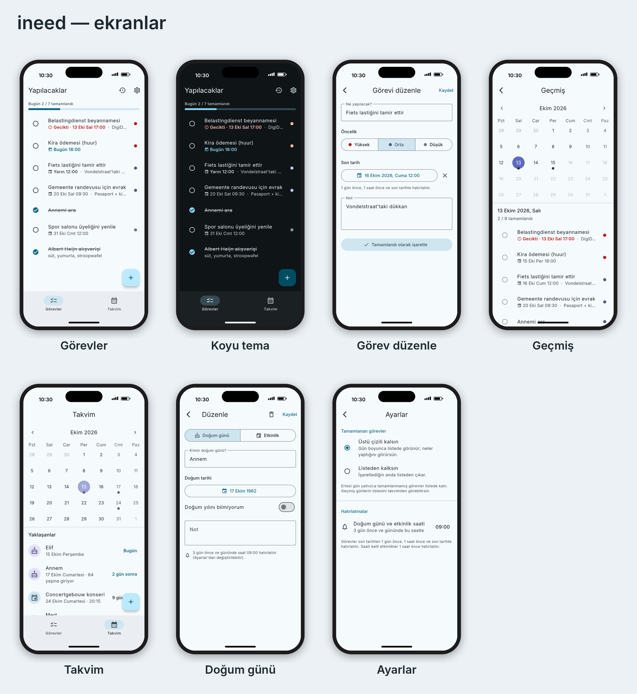

# ineed

Sade, kişisel bir yapılacaklar + doğum günü/etkinlik takvimi uygulaması (Flutter, önce iOS).

Yol haritası ve gün gün plan: [PLAN.md](PLAN.md)



Ekran görüntüleri uygulamanın gerçek ekranlarından üretilir (örnek verilerle):
`flutter test tool/screenshots --update-goldens && python3 tool/screenshots/frame.py`

## Özellikler

- **Görevler**: öncelik (Yüksek/Orta/Düşük), not, son tarih; "Gecikti / Bugün / Yarın" etiketleri
- **Tamamlananlar**: Ayarlar'dan *üstü çizili kalsın* veya *listeden kalksın*; ertesi gün liste yalnızca tamamlanmamışlarla başlar
- **Geçmiş**: takvimden bir gün seç, listenin o günkü hali (o gün tamamlananlar üstü çizili)
- **Takvim**: doğum günleri (yaş) ve etkinlikler, "Yaklaşanlar" listesi
- **Hatırlatmalar**: görevlerde 1 gün önce / 1 saat önce / son tarihte; doğum günü ve etkinliklerde 3 gün önce ve gününde 09:00

## iPhone'da denemek (Mac gerekir)

1. Flutter ve Xcode kurulu olsun (`flutter doctor` hepsini yeşil göstermeli)
2. Depoyu indir ve bu dala geç:
   ```sh
   git clone https://github.com/ozgekuzhan/ineed.git
   cd ineed
   git checkout claude/flutter-todo-app-5cymwg
   flutter pub get
   ```
3. Simülatörde: `open -a Simulator` sonra `flutter run`
4. Kendi iPhone'unda: `open ios/Runner.xcworkspace` → *Runner* → *Signing & Capabilities* → *Team* olarak Apple hesabını seç → iPhone'u kabloyla bağla → `flutter run`
   (İlk seferde iPhone'da *Ayarlar → Genel → VPN ve Cihaz Yönetimi*'nden geliştiriciye güvenmen gerekebilir.)

Bildirimleri denemek için 2-3 dakika sonrasına son tarihli bir görev ekleyip uygulamayı kapat.

## Kontroller

Her adımdan sonra aynı kontroller çalıştırılır (CI'da da otomatik, Amsterdam saat diliminde):

```sh
dart format --output=none --set-exit-if-changed lib test
flutter analyze
TZ=Europe/Amsterdam flutter test
```
